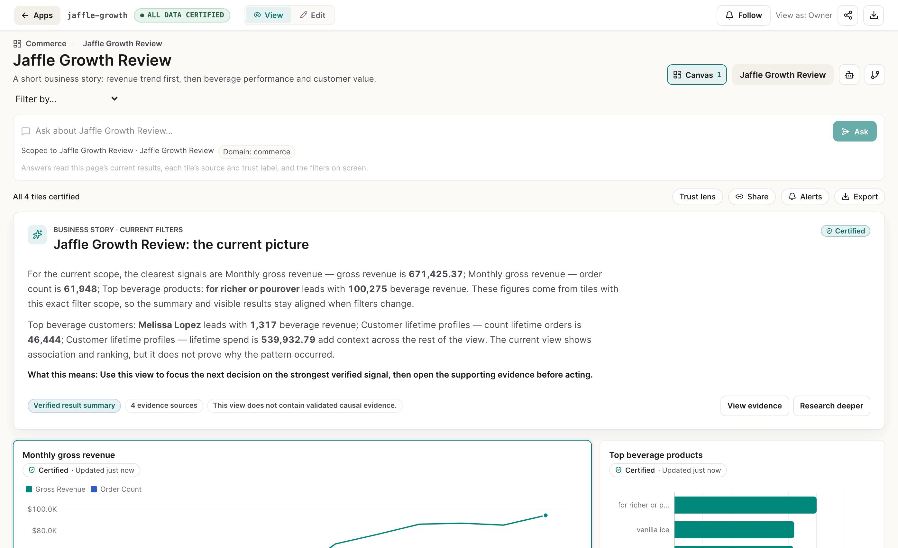
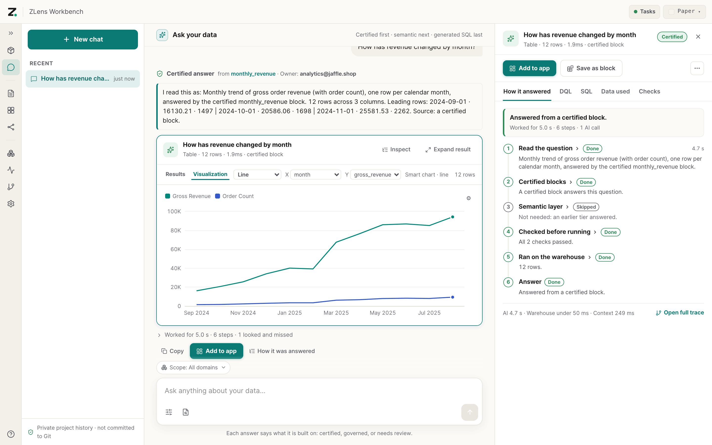
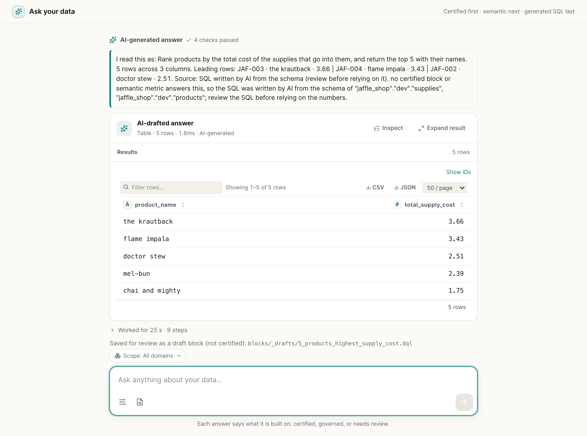
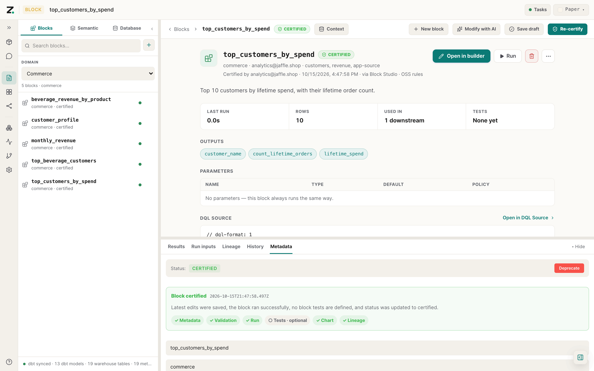
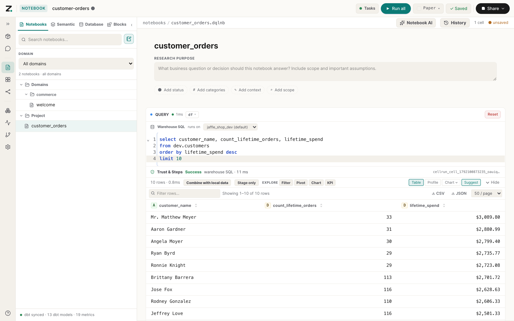
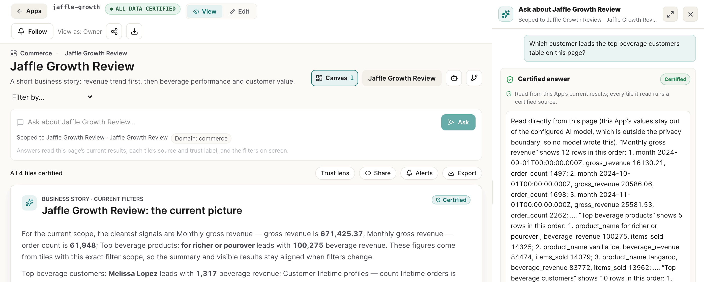
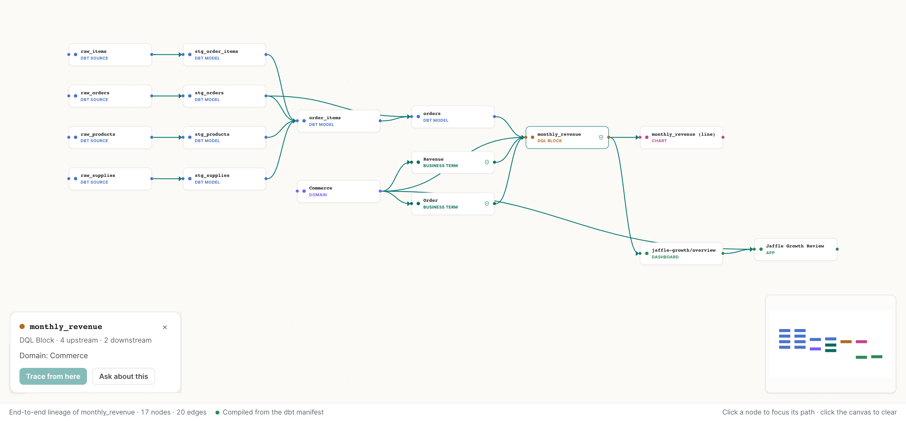

<p align="center">
  <picture>
    <source media="(prefers-color-scheme: dark)" srcset="docs/assets/brand/zlens-lockup-horizontal-reverse.svg">
    
  </picture>
</p>

<h3 align="center">Certified, or it says so.</h3>

<p align="center">
  Governed analytics for dbt teams. Every answer says what it is built on:<br>
  a certified block, your semantic metrics, or SQL that AI wrote and someone still needs to review.
</p>

<p align="center">
  <a href="https://github.com/duckcode-ai-labs/zlens/actions/workflows/ci.yml"></a>
  <a href="https://www.npmjs.com/package/@zlens/cli"></a>
  <a href="./LICENSE"></a>
  <a href="https://nodejs.org"></a>
</p>

<p align="center">
  <a href="https://duckcode-ai-labs.github.io/zlens/"><b>Docs</b></a> ·
  <a href="#quickstart"><b>Quickstart</b></a> ·
  <a href="https://duckcode-ai-labs.github.io/zlens/agents/"><b>AI agents (MCP)</b></a> ·
  <a href="./CONTRIBUTING.md"><b>Contributing</b></a>
</p>

<!-- overview.gif: add after #102 merges -->
<p align="center">
  
</p>

## What is ZLens?

ZLens is a local, open-source workbench that sits on top of your dbt project.
It turns the analytics people build on dbt (queries, notebooks, dashboards and
AI answers) into files you review in git, and it tells you how far to trust
each answer.

When someone asks a question, ZLens tries the most trusted source first and
labels what it used:

| Label | Answered from | Means |
|---|---|---|
| ● **Certified** | a certified block | Ran a block a person reviewed and certified, exactly as certified. |
| ◐ **Governed** | your semantic layer | Built from approved metrics and dimensions. |
| ○ **Needs review** | SQL written by AI | Grounded in your schema and checked before it runs, then saved as a draft block until someone certifies it. |

If none of these can answer safely, Ask refuses and says why. It never dresses
an unreviewed number up as a trusted one.

- **dbt stays the source of truth.** ZLens reads your manifest, semantic
  models and profiles; it does not replace dbt.
- **Everything is a file.** Blocks (`.dql`), notebooks (`.dqlnb`) and Apps live
  in your repo, so they are diffed, reviewed and versioned like code.
- **Works with your coding agent.** A built-in MCP server gives Claude Code,
  Codex, Cursor and Claude Desktop the same certified-first answers and labels.
- **Runs on your terms.** Use a Claude or ChatGPT subscription, an API key
  (Anthropic, OpenAI, Gemini or any OpenAI-compatible endpoint), or a local
  model through Ollama. No ZLens account or hosted service, and no usage telemetry.

## Quickstart

Run ZLens on the Jaffle Shop sample dbt project. It takes about ten minutes
and needs Node.js 20 or newer, Python 3.9 to 3.13 and git. No warehouse
account is needed.

**1. Get the sample dbt project and build its DuckDB database**

```bash
git clone https://github.com/duckcode-ai/jaffle-shop-duckdb.git
cd jaffle-shop-duckdb
python3 -m venv .venv
.venv/bin/pip install -r requirements.txt
.venv/bin/dbt deps --profiles-dir .
.venv/bin/dbt seed --profiles-dir .
.venv/bin/dbt build --profiles-dir . --exclude resource_type:seed
```

> [!NOTE]
> The sample also has a `setup.sh` script. It installs an old pre-ZLens CLI,
> so use the commands above instead.

**2. Add ZLens, import the dbt project and open the workbench**

```bash
npx create-zlens-app@latest dql
cd dql
npm install
npm install --prefix .dql/connectors duckdb
npm run sync
npm run notebook
```

The terminal prints `Notebook ready: http://127.0.0.1:3474` and your browser
opens it.

**3. Finish Guided Setup and run a query**

Guided Setup walks you through four steps: **Preview** and **Apply project**
for the dbt project, **Import & test** for the `jaffle_shop` profile, an optional AI
provider, then **Finish setup**. Then open **Notebooks → New Notebook**, click
**Create DQL query → Switch to SQL cell**, and run this with **Shift+Enter**:

```sql
select customer_name, count_lifetime_orders, lifetime_spend
from dev.customers
order by lifetime_spend desc
limit 10
```

Next: [ask a question in plain English](https://duckcode-ai-labs.github.io/zlens/ask/),
[save the query as a block and certify it](https://duckcode-ai-labs.github.io/zlens/blocks/),
or [add ZLens to your own dbt project](https://duckcode-ai-labs.github.io/zlens/get-started/your-dbt-project/).
The full walkthrough is the [Quickstart guide](https://duckcode-ai-labs.github.io/zlens/get-started/).

<details>
<summary><b>Install the CLI globally, upgrade, or connect another database</b></summary>

<br>

`create-zlens-app` installs the CLI into your project, so `npm run …` and
`npx zlens …` use the version that project was tested with. To have a `zlens`
command everywhere:

```bash
npm i -g @zlens/cli          # install or upgrade
zlens --version
cd your-dbt-repo && zlens init ./dql
```

Install only the driver your warehouse needs, into the project:

| Database | Install before running queries |
|---|---|
| Databricks SQL | nothing (built in, over HTTPS) |
| DuckDB, or local CSV / Parquet / JSON files | `npm install --prefix .dql/connectors duckdb` |
| Snowflake | `npm install --prefix .dql/connectors snowflake-sdk` |

The notebook's Connections page can install DuckDB or Snowflake for you. See
[Install](https://duckcode-ai-labs.github.io/zlens/get-started/install/),
[Connect a database](https://duckcode-ai-labs.github.io/zlens/get-started/connect-database/),
[Connectors](https://duckcode-ai-labs.github.io/zlens/reference/connectors/) and
[Troubleshooting](https://duckcode-ai-labs.github.io/zlens/guides/troubleshooting/).
Coming from the `dql` command and `@duckcodeailabs/dql-cli`? Install
`@zlens/cli`; the [install guide](https://duckcode-ai-labs.github.io/zlens/get-started/install/)
covers the switch.

</details>

## Features

### Ask, with a trust label and the receipts

Ask a question in plain English. The answer opens with its trust label, the
block or metrics it came from and their owner. **How it was answered** shows
every step: the certified blocks it checked, the semantic layer, the checks
before running, and the exact DQL and SQL that ran.

<p align="center">
  
</p>

When no certified block or metric fits, AI writes the SQL from your schema.
ZLens checks it before it runs, labels the answer **AI-generated**, and saves
it as a draft block for someone to review. It never certifies itself.

<p align="center">
  
</p>

[Ask a question](https://duckcode-ai-labs.github.io/zlens/ask/) ·
[How Ask answered](https://duckcode-ai-labs.github.io/zlens/ask/how-it-answered/) ·
[Answers that need review](https://duckcode-ai-labs.github.io/zlens/ask/needs-review/)

### Blocks: save is a draft, certify is a person

A block is a named, reusable query in a `.dql` file with an owner, a
description, tests and a chart. Save a notebook cell with **Save Block**, and
it is a draft. **Certify** runs the block and its checks; only if they pass
does it become Certified, with a receipt of who certified it, when, and under
which rules.

<p align="center">
  
</p>

[Blocks](https://duckcode-ai-labs.github.io/zlens/blocks/) ·
[Save and certify](https://duckcode-ai-labs.github.io/zlens/blocks/certify/)

### Notebooks

Explore with SQL, DQL, Ask AI, note and input cells against your warehouse.
Results show with filters, pivots, charts and CSV or JSON export. The notebook
is a `.dqlnb` file; results stay out of git.

<p align="center">
  
</p>

[Work in a notebook](https://duckcode-ai-labs.github.io/zlens/notebooks/)

### Apps and dashboards

Build Apps from blocks for the people who read the numbers. Every tile carries
its trust label and a receipt, and the page says how much of it is certified.
Ask about an App and the answer reads that page's own results and filters, and
takes the trust of the weakest tile it read.

<p align="center">
  
</p>

[Read an App](https://duckcode-ai-labs.github.io/zlens/apps/) ·
[Ask about an App](https://duckcode-ai-labs.github.io/zlens/apps/ask-about-an-app/)

### Lineage, from dbt to the App

Trace any block, App or notebook end to end: dbt sources and models, business
terms, the block, its chart, the dashboard page and the App. Lineage is built
from your dbt manifest and ZLens files, in the workbench or with
`zlens lineage`.

<p align="center">
  
</p>

[Lineage](https://duckcode-ai-labs.github.io/zlens/lineage/)

### AI agents over MCP

Point your coding agent at the project and it answers data questions the way
Ask does: certified blocks first, the same trust labels, AI-written SQL kept
as a draft for review.

```console
$ npm exec -- zlens connect claude-code

  ZLens agent connection setup
    Project: /path/to/jaffle-shop-duckdb/dql

  ✓ Claude Code
    Project .mcp.json and CLAUDE.md now point Claude Code at ZLens.
    Next: Open Claude Code from this project and run /mcp to confirm the dql server is loaded.

  Verify before asking an agent: zlens mcp test
```

`zlens connect` also supports `codex`, `cursor`, `claude-desktop` and `all`.
Keep `npm run notebook` running while the agent works: it runs the queries.

[Connect your AI agent](https://duckcode-ai-labs.github.io/zlens/agents/) ·
[MCP tools](https://duckcode-ai-labs.github.io/zlens/agents/tools/)

## How it works

<p align="center">
  <a href="docs/assets/architecture/dql-flow.svg">
    
  </a>
</p>

1. **Sync.** `zlens sync dbt` reads your dbt manifest, semantic models and
   warehouse shape into a local index.
2. **Certify.** Blocks are reviewed queries with an owner and tests.
   Certifying records who vouched for them.
3. **Compile.** `zlens compile` writes `dql-manifest.json`: every block,
   metric, notebook and App, with lineage and trust.
4. **Serve.** Apps, notebooks, Ask, your agent over MCP and `zlens verify` in
   CI all use the same certified blocks instead of each inventing its own SQL.

DQL is the query language ZLens blocks are written in. See
[Concepts](https://duckcode-ai-labs.github.io/zlens/get-started/concepts/),
[the DQL language](https://duckcode-ai-labs.github.io/zlens/reference/language/)
and the [architecture overview](https://duckcode-ai-labs.github.io/zlens/architecture/overview/).

## Packages

ZLens ships as 18 npm packages. Most people only need `create-zlens-app` or
`@zlens/cli`.

<details>
<summary><b>All packages</b></summary>

<br>

| Package | What it is |
|---|---|
| [`@zlens/cli`](./apps/cli) | The `zlens` command: workbench, sync, compile, certify, lineage, Ask and the MCP server |
| [`create-zlens-app`](./packages/create-dql-app) | Scaffolds a ZLens project next to your dbt project |
| [`@zlens/core`](./packages/dql-core) | DQL language core: lexer, parser, AST and semantic analysis |
| [`@zlens/dql-compiler`](./packages/dql-compiler) | DQL compiler: IR lowering, Vega-Lite generation, HTML and CSS output |
| [`@zlens/runtime`](./packages/dql-runtime) | Browser runtime: data fetching, Vega rendering, hot reload |
| [`@zlens/project`](./packages/dql-project) | Project and block registry: block metadata, versions, sync and storage |
| [`@zlens/governance`](./packages/dql-governance) | Block testing, certification, cost estimation and access policies |
| [`@zlens/connectors`](./packages/dql-connectors) | Connectors for local files, SQL warehouses and lakehouse engines |
| [`@zlens/notebook`](./packages/dql-notebook) | Notebook document model and execution helpers |
| [`@zlens/agent`](./packages/dql-agent) | The agent: knowledge graph, Skills, block-first answer loop, LLM providers |
| [`@zlens/mcp`](./packages/dql-mcp) | MCP server exposing certified blocks, semantic layer, lineage and governance |
| [`@zlens/charts`](./packages/dql-charts) | React SVG chart components for blocks |
| [`@zlens/ui`](./packages/dql-ui) | Design tokens, theme provider and headless UI primitives |
| [`@zlens/dql-lsp`](./packages/dql-lsp) | DQL language server |
| [`@zlens/slack`](./packages/dql-slack) | Slack slash-command bot that answers through the block-first agent loop |
| [`@zlens/openlineage`](./packages/dql-openlineage) | OpenLineage events for block and notebook runs |
| [`@zlens/plugin-api`](./packages/dql-plugin-api) | Plugin contracts: connectors, chart renderers, governance rule packs |
| [`@zlens/telemetry`](./packages/dql-telemetry) | Deprecated and unused: ZLens sends no usage telemetry |

</details>

## Contributing

Contributions are welcome. Start with [CONTRIBUTING.md](./CONTRIBUTING.md) and
the [repository layout](./docs/contribute/repo-layout.md); the
[roadmap](./ROADMAP.md) shows what is planned. Please follow the
[code of conduct](./CODE_OF_CONDUCT.md).

## Community and support

- **Bugs and feature requests:** [open an issue](https://github.com/duckcode-ai-labs/zlens/issues/new/choose).
- **Questions and proposals:** see [SUPPORT.md](./SUPPORT.md) for where to go and how issues are triaged.
- **Security issues:** follow [SECURITY.md](./SECURITY.md); do not open a public issue.

## License

ZLens is licensed under the [Apache License 2.0](./LICENSE); see also
[NOTICE](./NOTICE) and [THIRD_PARTY_NOTICES.md](./THIRD_PARTY_NOTICES.md).

<details>
<summary>Licences of releases before the ZLens rename</summary>

<br>

`create-dql-app`, `@duckcodeailabs/dql-openlineage`,
`@duckcodeailabs/dql-plugin-api` and `@duckcodeailabs/dql-telemetry` were
published as MIT up to and including 1.17.2; every later release is
Apache-2.0. Versions already on npm keep the licence they were published under.

</details>
