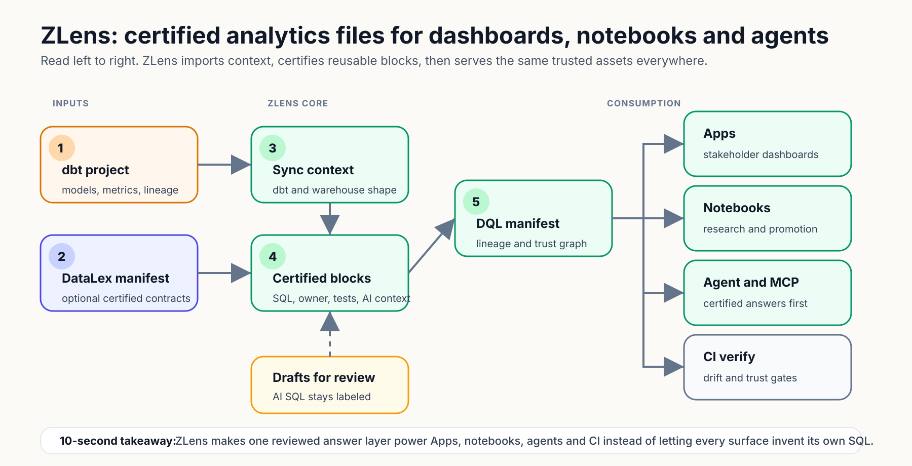

# ZLens

[](https://github.com/duckcode-ai-labs/zlens/actions/workflows/ci.yml)
[](https://www.npmjs.com/package/zlens)
[](./LICENSE)
[](https://nodejs.org)

**ZLens is a Git-versioned, governed analytics layer for
dbt teams, with an AI agent that answers from reviewed context instead of
guessing.** You write the analytics as blocks in DQL (Domain Query Language),
ZLens's query language.

It turns dbt models, semantic metrics, SQL, notebooks, and Apps into reviewable
files, then answers business questions through a governed cascade — certified
blocks first, semantic metrics next, generated SQL last — with every answer
carrying a trust label. dbt stays the source of truth; the analytics layer on
top becomes trustworthy too, with certified blocks, lineage, tests, and source
control.

**Why ZLens is different**

- **Grounded, not hallucinated.** Generated SQL is grounded in your schema,
  validated, and executed. A query that returns no rows or can't be grounded is
  flagged **review-required** — never dressed up as a confident, "trusted" number.
- **Works with your coding agent.** A built-in MCP server lets Claude Code,
  Codex, Cursor, and Claude Desktop ask questions and build governed blocks with
  the same trust guards as the UI → [Connect an AI agent](./docs/guides/mcp.md).
- **Runs on your terms.** Use your Claude or ChatGPT subscription, an API key,
  or a fully local model via Ollama.

## Architecture flow

ZLens turns governed analytics work into executable, reviewable files. Certified
blocks serve trusted answers first; notebooks and AI-generated SQL stay
review-required until promoted.

> Click the diagram to open the full-size SVG in a browser tab, where you can
> zoom or use full-screen mode.

<p align="center">
  <a href="docs/assets/architecture/dql-flow.svg">
    
  </a>
</p>

**Why users care:** ZLens makes dashboards, notebook research, and AI answers use
the same reviewed assets, with clear labels when analysis is still draft.

## Start here

Use one of these two paths.

### Path 1: Try ZLens on the Jaffle Shop sample dbt project

The sample is a plain dbt + DuckDB project in a separate repository. It does
not ship a `dql/` folder, so you create one with `create-zlens-app`.

```bash
git clone https://github.com/duckcode-ai/jaffle-shop-duckdb.git
cd jaffle-shop-duckdb
./setup.sh                        # the example's own setup script
dbt parse                         # only if target/manifest.json is missing

npx create-zlens-app@latest dql
cd dql
npm install
npm install --prefix .dql/connectors duckdb
npm run sync
npm run notebook
```

Open the local URL printed in the terminal, usually `http://127.0.0.1:3474`.

What to check first:

1. Home shows dbt artifacts and the database connection.
2. Lineage shows how the dbt models connect.
3. In a notebook, run a query against a Jaffle Shop model.

The example repository pins an old release under the previous package name (`@duckcodeailabs/dql-cli`
1.7.1, Node `>=20 <23`), so its own docs and tutorial may not match the current
CLI. Use the commands above until it is updated.

### Path 2: Add ZLens to your own dbt repo

Run this from the root of an existing dbt project.

```bash
cd your-dbt-repo
dbt parse

npx create-zlens-app@latest dql
cd dql
npm install
npm run doctor
npm run sync
npm run notebook

# Optional, only before running queries with these drivers:
# npm install --prefix .dql/connectors duckdb        # DuckDB or local files
# npm install --prefix .dql/connectors snowflake-sdk # Snowflake
# Databricks does not need an extra package.
```

`dbt parse` should create `target/manifest.json`. ZLens also reads dbt artifacts
such as `catalog.json`, `semantic_manifest.json`, and `run_results.json` when
they exist.

Install only the database driver your project uses:

| Database | Extra install before running queries | Notes |
| --- | --- | --- |
| Databricks SQL | none | Built into ZLens through HTTPS |
| DuckDB or local CSV/Parquet/JSON files | `npm install --prefix .dql/connectors duckdb` | Needed for `duckdb` and `file` connections |
| Snowflake | `npm install --prefix .dql/connectors snowflake-sdk` | Needed for Snowflake password, key-pair, SSO, OAuth, PAT, MFA, and workload identity auth |

The notebook Connections page can also install DuckDB or Snowflake into
`.dql/connectors/`. This keeps the base ZLens install fast while each project
opts into the warehouse package it actually needs.

If you installed the CLI globally, installation only gives you the `zlens`
command. It does not create a `dql/` folder by itself. Bootstrap the folder
explicitly:

```bash
cd your-dbt-repo
zlens init ./dql
cd dql
zlens doctor
zlens compile
zlens sync dbt
zlens notebook
```

## Install and upgrade the CLI

ZLens is plain npm packages. Most users install the CLI project-locally (via
`create-zlens-app`, above), but you can also install it globally:

```bash
npm i -g @zlens/cli        # install
zlens --version
```

Upgrading is just re-installing the latest — there is no separate updater:

```bash
npm i -g @zlens/cli@latest # global
npm i -D @zlens/cli@latest # project-local (then: npx zlens --version)
```

Coming from `@duckcodeailabs/dql-cli` and the `dql` command? See
[Upgrading from the `dql` command](docs/03-install.md#upgrading-from-the-dql-command).

### How to run project-local and global commands

Project-local installation is recommended because each repository keeps the
CLI version it was tested with. npm links that CLI at
`node_modules/.bin/zlens`; it does not add the link to your interactive shell's
`PATH`.

| Installation | Use | Example |
| --- | --- | --- |
| Scaffolded/project-local | A provided npm script | `npm run doctor` |
| Project-local, any command | `npm exec -- zlens <command>` | `npm exec -- zlens model list` |
| Project-local shorthand | `npx zlens <command>` | `npx zlens --help` |
| Global | `zlens <command>` | `zlens doctor` |

This means `npm run doctor` can work while a bare `zlens doctor` says
`command not found`: the former uses the repository's local binary, while the
latter requires the global installation shown above. Confirm which CLI you are
using with:

```bash
npm exec -- zlens --version   # project-local
zlens --version               # global, if installed
```

The starter project includes scripts for the daily workflow. Use
`npm exec -- zlens ...` for every other command:

| Goal | Project-local command |
| --- | --- |
| Check installation and configuration | `npm run doctor` |
| Open the notebook UI | `npm run notebook` |
| Refresh dbt artifacts and indexes | `npm run sync` |
| Compile and validate the project | `npm run compile` then `npm run validate` |
| Inspect lineage | `npm run lineage` |
| List or validate Domain Packages | `npm exec -- zlens model list` / `npm exec -- zlens model validate` |
| Create or import governed content | `npm exec -- zlens new ...` / `npm exec -- zlens import sql ...` |
| Format, diff, certify, and verify | `npm exec -- zlens fmt ...`, `npm exec -- zlens diff ...`, `npm exec -- zlens certify ...`, `npm exec -- zlens verify` |
| Ask, evaluate, or connect an agent | `npm exec -- zlens agent ...`, `npm exec -- zlens eval ...`, `npm exec -- zlens connect ...` |

Run `npm exec -- zlens --help` for the live command list, or use the
[complete CLI reference](./docs/reference/cli.md) for commands, subcommands,
flags, examples, and exit codes.

> **Stuck on `zlens: command not found` after installing?** A failed
> `npm i -g` never links the `zlens` binary. Reinstall `@latest` on any Node 20 or
> newer. The escape hatch that needs no PATH setup at all is
> `npx -p @zlens/cli@latest zlens notebook`.
> More in the [install guide](docs/03-install.md#upgrade) and
> [troubleshooting](docs/guides/troubleshooting.md#zlens-says-command-not-found).

## Before you install

- Use Node `20` or newer. CI tests Node 20, 22, and 24.
- Use npm `10+`.
- Use a dbt project if you want dbt import and lineage.
- Python and native build tools are only needed when native database packages
  cannot use prebuilt binaries.

On macOS, if npm falls back to native compilation, install the command-line
tools once:

```bash
xcode-select --install
```

## Why install can feel slow

ZLens uses a flat CLI install by default. Heavy warehouse drivers are not bundled
into the global install. Databricks SQL works through the built-in HTTP
connector, while DuckDB and Snowflake can be installed project-locally from the
notebook connection panel when needed.

Most slow installs now come from optional native packages installed for a
specific project, older Node versions, locked-down networks, or missing build
tools.

If install is slow, check this first:

```bash
node -v
npm -v
python3 --version
# macOS only:
xcode-select -p
```

Expected Node versions are `v20.x` or newer (`v22.x` and `v24.x` are tested).
If an optional connector install shows `node-gyp rebuild`, switch to Node `22`
LTS and retry:

```bash
rm -rf node_modules package-lock.json
npm install --foreground-scripts
```

For Linux, install `python3`, `make`, and `g++`. For Windows, install the
Microsoft C++ Build Tools.

## First 10-minute tutorial

1. Open Home.
   Confirm ZLens found your dbt project and compiled artifacts.

2. Connect the database.
   If dbt `profiles.yml` or `profiles.yaml` exists, ZLens can read the connection
   shape. Enter any local credentials that are not stored in the profile, then
   test the connection.

3. Review imported objects.
   Check dbt models, sources, semantic metrics, and database tables before
   building blocks.

4. Create your first block.
   Use a dbt model, a semantic metric, imported SQL, or the local AI builder.
   Keep the block small and tied to one trusted business question.

5. Run and certify.
   Run the block, review results, add validation/tests where needed, then click
   **Certify**. Saving never certifies: saved work is a draft until a person
   certifies it, and certification records who did it.

6. Use notebooks.
   Search blocks, add cells, edit SQL/DQL, run research from source cells, and
   promote reviewed SQL into draft DQL blocks.

7. Push to an App.
   Build a local App from certified blocks and notebooks so stakeholders see a
   clean dashboard-style view.

8. Check lineage and source control.
   Confirm the path from source tables to dbt models, blocks, notebooks,
   dashboards, and Apps. Review file changes before committing.

## Daily commands

Run these from the `dql/` workspace.

```bash
npm run notebook   # open the local UI
npm run sync       # refresh dbt models, artifacts, and lineage
npm run compile    # compile DQL files
npm run validate   # validate blocks and project files
npm run lineage    # inspect lineage from the CLI
```

## Connect AI agents

ZLens includes an MCP server for Claude Code, Codex, Cursor, Claude Desktop, and
other MCP clients. The server routes questions through certified blocks first,
uses project metadata for safe generated SQL previews, and saves each
review-required answer as a draft block for review (the same as Ask in the UI
and `zlens agent ask`; repeats reuse the same draft).

```bash
npm exec -- zlens mcp test
npm exec -- zlens connect claude-code   # writes .mcp.json and CLAUDE.md
npm exec -- zlens connect codex         # writes .codex/config.toml and AGENTS.md
```

See [Connect an AI agent](./docs/guides/mcp.md) for Claude Desktop, Cursor,
remote MCP server config, and SDK provider notes.

## Core concepts

- **Term**: a governed business definition.
- **Block**: a reusable SQL or semantic answer with owner, description, tests,
  chart intent, and AI context.
- **Business view**: a composed business object that groups terms, blocks, and
  nested views.
- **Notebook**: analysis as code, with SQL/DQL cells and live results.
- **App**: a stakeholder-facing local app built from governed blocks and
  notebooks.
- **Lineage**: the graph from source data to dbt models, DQL blocks, notebooks,
  dashboards, and Apps.

## Documentation

All docs live in [`docs/`](./docs/). Start with these:

- [Quickstart](./docs/01-quickstart.md)
- [Install](./docs/03-install.md)
- [Tutorials](./docs/tutorials/README.md)
- [Import dbt](./docs/guides/import-dbt.md)
- [Block Studio](./docs/guides/block-studio.md)
- [Notebook research engine](./docs/guides/notebook-research.md)
- [Author a block](./docs/guides/authoring-blocks.md)
- [Connectors](./docs/reference/connectors.md)
- [CLI reference](./docs/reference/cli.md)
- [Troubleshooting](./docs/guides/troubleshooting.md)
- [End-to-end Jaffle Shop example](https://github.com/duckcode-ai/jaffle-shop-duckdb/blob/main/docs/tutorials/jaffle/README.md)

## What is included in OSS

- Local notebook UI
- Block Studio
- dbt artifact import
- dbt `profiles.yml` connection discovery
- Database connectors for local and warehouse development
- Apps
- Lineage
- Source control workflow
- Local agent/MCP runtime
- No usage telemetry

ZLens OSS is a single-user local workspace. Hosted multi-user governance,
managed secrets, audit logs, approval workflows, and permissions-aware team
retrieval belong to the commercial product.

## Privacy

The ZLens CLI does not send usage telemetry. There is no `zlens telemetry` command.
The unused `@duckcodeailabs/dql-telemetry` package is deprecated (see its
[README](./packages/dql-telemetry/README.md)).

## Contributing

See [CONTRIBUTING.md](./CONTRIBUTING.md) and
[docs/contribute/repo-layout.md](./docs/contribute/repo-layout.md). Bugs and
feature requests: [open an issue](https://github.com/duckcode-ai-labs/zlens/issues).

## License

Every package in this repository is licensed under the
[Apache License 2.0](./LICENSE); see also [NOTICE](./NOTICE). Each npm package
ships both files. Third-party material and its licences are listed in
[THIRD_PARTY_NOTICES.md](./THIRD_PARTY_NOTICES.md).

`create-dql-app`, `@duckcodeailabs/dql-openlineage`,
`@duckcodeailabs/dql-plugin-api` and `@duckcodeailabs/dql-telemetry`
(the package names before the ZLens rename) were published as MIT up to and including 1.17.2; every later release is
Apache-2.0. Versions already on npm keep the licence they were published under.
