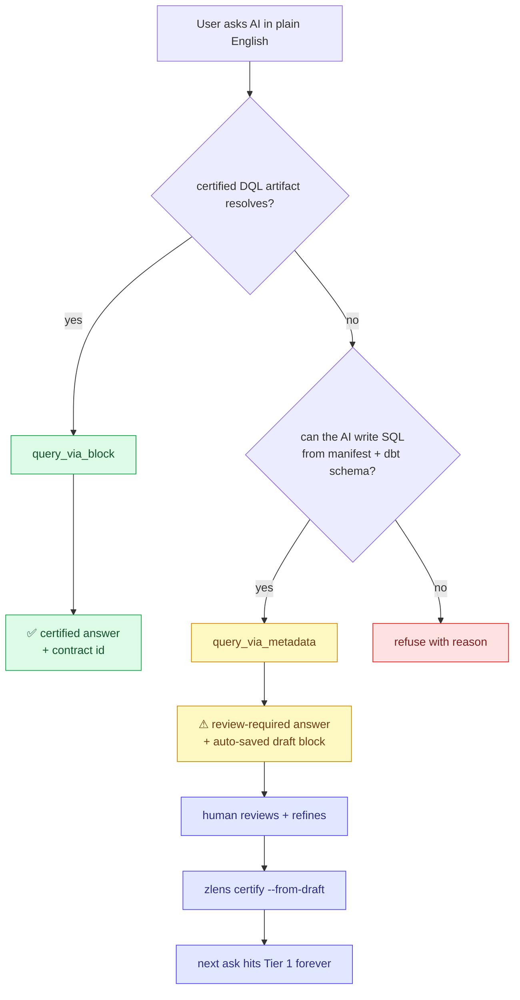

# Graduated trust + the promotion loop

ZLens's wedge — _one question, one answer, fully traced_ — depends on certified
DQL artifacts. Blocks answer executable data questions; business terms and
business views answer definition/context questions and help route to the right
blocks. But real AI usage isn't strict-only: agents will ask questions for
which no certified block exists yet, and refusing every such ask sends users
to bypass the MCP and write SQL directly. That defeats the wedge.

ZLens's answer is **graduated trust**: three tiers the AI agent walks in
priority order, with the trust label always visible to the human.



## Tier 1 — certified DQL context

For data answers, the wedge proper is `query_via_block`. It always refuses anything that isn't
`status = "certified"`. The DataLex contract gate is layered on top and is conditional:

- When the project has a DataLex manifest configured, a certified block that declares a
  `datalex_contract` must also resolve that contract in the loaded `datalex-manifest.json` —
  otherwise it is refused.
- Projects that have not adopted DataLex still serve certified blocks; the contract gate is simply
  skipped (`query_via_block` only checks it when the registry `isLoaded()`). The analyzer surfaces a
  compile-time warning so the skipped check is visible.

Agents ALWAYS try certified project context first. Business terms and
business views can be selected as certified context for definition-style
questions, and they also attach to block answers as evidence. For executable
answers, the result is safe to ship to dashboards because every output column
traces back through the contract → dbt model → source column.

## Tier 2 — review-required answers leave a draft

Use when Tier 1 returns no match. ZLens (or, on the BYOSQL path, the agent)
writes SQL from the manifest + dbt schema and the runtime executes it. The
answer is labelled **review required** (`uncertified: true` on MCP) and the
proposal is **auto-saved as a draft block** so a person can review and certify
it. This is the same on every surface:

| Surface | What leaves the draft |
| --- | --- |
| Notebook UI Ask | `POST /api/agent-runs`; the answer shows *Saved for review as a draft block* with an **Open draft to review** action |
| `zlens agent ask` | `POST /api/agent-runs`; prints `Review draft saved: <path>` and the `zlens certify --from-draft` command |
| MCP `answer_question` | `POST /api/agent-runs`; returns `reviewDraft` / `draftBlockPath` |
| MCP `query_via_metadata` | writes the draft itself (`saveDraft: false` opts out) |

Where and how:

- Domain-first projects use `domains/<domain>/blocks/_drafts/<slug>.dql`;
  legacy projects use `blocks/_drafts/<slug>.dql`. The Blocks list shows them
  under **Drafts** with status `draft`.
- The draft is always `status = "draft"`. Capturing an answer never certifies it.
- Repeats do not create new files. The draft carries `answer_fingerprint` (a
  sha256 of the answer SQL with comments, case and whitespace normalized); the
  same SQL asked in other words, or the same question asked again, increments
  `asked_times` on the existing draft. Questions that get asked repeatedly are
  the strongest candidates for certification.
- The answer's executed DQL artifact stays `persistence = "transient"`: it is
  the execution receipt and is never replaced by a file. The saved draft is a
  separate copy, reported on the run as `reviewDraft { path, askedTimes,
  created }`.
- Only executed Ask answers are captured: certified answers, refusals,
  clarifications, authoring modes (Block AI, App builder, which keep their own
  explicit *Add to Block Studio* commits), evaluation runs
  (`reviewDraftCapture: "off"`) and host-run (multi-user) runtimes are not.

For follow-up drilldowns, Tier 2 is also context-aware. A prior certified
answer can seed the next request, but the agent must first search for a
distinct certified drilldown block that matches the requested filter or
dimension. If none exists, it emits a review-ready draft proposal with the
requested filters/dimensions in the evidence route. Generated drilldown SQL
stays uncertified until review and promotion.

```typescript
queryViaMetadata({
  question: "How many active customers in Q1?",
  proposedSql: "SELECT COUNT(DISTINCT customer_id) FROM fct_orders WHERE …",
  proposedDomain: "customer",
  proposedEntity: "Customer",
  upstreamRefs: ["fct_orders"],
});
```

The agent contract: surface `uncertified: true` verbatim to the human, and
mention the path forward — `zlens certify --from-draft <path>`.

## Saving never certifies

Nothing becomes certified implicitly. Saving — an Ask answer, a notebook cell
(*Save draft block*), an imported SQL candidate (*Save draft*), or a block in
Block Studio — always writes `status = "draft"`, and the companion YAML
(`semantic-layer/blocks/.../<slug>.yaml`) always says the same `reviewStatus`
as the `.dql` file.

A block becomes certified only through an explicit **Certify** action, which
runs the certification rules (owner, a successful compile and run, passing
tests; `--enterprise` adds grain, outputs, lineage, pattern and cadence) and,
only when they pass, writes `status = "certified"` and a **certification
receipt** beside `reviewStatus: certified`:

```yaml
reviewStatus: certified
certification:
  certifiedBy: analyst@example.com   # host's signed-in person, else the local owner
  certifiedAt: '2026-10-14T12:00:00.000Z'
  via: block-studio                  # block-studio | sql-import | app-dataset | cli
  rules: oss                         # oss | enterprise
  sourceSha256: 5f0c…                # the exact source that was certified
  checks: [metadata, validation, run, tests]
```

The explicit Certify actions are Block Studio's **Certify**, the import
candidate's **Certify**, App Studio's **Certify and use this data** (a Dataset
from a table), and `zlens certify --from-draft`. Block Studio shows the receipt
as *Certified by … · when · via …*. Changing a block's status away from
certified removes the receipt.

Certifying is the review, so it also removes the `review-required` lifecycle
tag that SQL import, AI drafts and notebook research put on a draft (in the
`.dql` and in the companion YAML). Ask never serves a block that is certified
while its tags or description still say it needs review, so Certify refuses a
description that says "review required" until it is edited. A block certified
before this rule, which still carries the tag, is named with the reason when a
question asks for it; certifying it again clears the tag.

### Asking for a block by name

A question that names a block as a block ("using the certified block *Top
scorers*", "the *Top scorers* block") is answered by that block when its
contract can answer: its declared parameters are bound from the question (a
`LIMIT ${top_n}` takes the question's "top 5"), and a period its own SQL fixes
(`EXTRACT(YEAR FROM game_date) BETWEEN 2016 AND 2017`) satisfies a question
about exactly that period. When it cannot, the answer says why in the block's
terms ("the block does not accept a filter on season", "the block is fixed to
game_date from 2016-01-01 up to 2018-01-01") and what it does accept, and
offers review-required exploration as an explicit next step. It is never
handed to AI-written SQL on its own, and the words of a block's name are never
treated as values the SQL must filter on. A follow-up that narrows a certified
block's answer ("Only guards.") is held to that block the same way. Naming a
draft or retired block says so at once, with what to do.

## Apps: one trust state per page

An App page shows one aggregate data trust, derived from its current tiles'
run evidence (the server resolves each tile against its source as it is now):
the header badge, the *N of M tiles certified* line, the story's trust pill and
every tile badge read the same value (`appTrustSummary` in `@zlens/core`).
"All data certified" and "verified" wording appear only when every data tile
ran from a certified source and no App draft is pending; before the page runs,
the badge says *Trust not checked yet* — a saved dashboard's own fields are
never enough to claim certified. The tile and story vocabulary is the same:
Certified, Governed, Needs review, Blocked.

An App's **lifecycle** (draft, in review, certified) is a separate axis. The
App library card shows lifecycle only, worded *App draft* / *App in review* /
*App certified*, so it cannot be read as data trust.

## Tier 3 — refuse

When the question is unanswerable from any data the project has, the agent
must refuse and say why. Hallucinating an answer breaks the wedge.

## The promotion loop

Tier-2 captures aren't dead-end answers — they're the input to a review
workflow that turns ad-hoc AI proposals into certified contracts.

1. **Capture** — `query_via_metadata` writes a draft block with a
   `_proposed { ... }` provenance block (asking time, asked-times counter,
   proposed domain/entity, suggested contract id).
2. **Surface** — `list_proposals` returns drafts ranked by `asked_times`
   descending. Wire it into a review dashboard or run it in your terminal:
   `mcp call list_proposals --asked-at-least-times 3`.
3. **Refine** — A human edits the SQL, names the contract, sets ownership.
   Standard git workflow — open a PR, request review.
4. **Certify** — `zlens certify --from-draft <path>` does the promotion,
   only after the promoted source passes the same certification rules Block
   Studio's Certify runs (it asks a short-lived local runtime for its
   read-only certification check; nothing is written if a rule fails):
   - Moves `domains/<domain>/blocks/_drafts/<slug>.dql` →
     `domains/<domain>/blocks/<slug>.dql` in domain-first projects, or
     `blocks/_drafts/<slug>.dql` → `blocks/<domain>/<slug>.dql` in legacy
     projects
   - Flips `status = "draft"` to `"certified"`
   - Sets `datalex_contract = "<id>@<version>"`
   - Drops the `_proposed` provenance block and Tier-2 capture fields
   - Writes the certification receipt into the block's companion YAML
   - Surfaces the patch the human still needs to apply to
     `datalex-manifest.json` (so the contract id resolves)
5. **Forever** — Next time the same question is asked, Tier 1 hits. Same
   answer, every time.

Example end-to-end:

```bash
# Step 4 — promote a draft after review
zlens certify --from-draft domains/customer/blocks/_drafts/active_customers_by_quarter.dql \
            --domain customer \
            --contract commerce.Customer.active_customers_by_quarter@1 \
            --owner growth@example.com

# Step 5 — refresh the manifest so the new certified block is indexed
zlens compile

# Apply the patch the previous step printed to datalex-manifest.json
# (or wait for the DataLex compiler to emit it once the v1 emitter ships).
```

## Why this is in OSS, not commercial

The strategic line — language primitives stay OSS, shared multi-user state
goes commercial — applies cleanly:

- **OSS (in the box today):** Tier-2 capture, draft writer, `zlens certify
  --from-draft`, `list_proposals`, single-user review. Uses git as the
  shared store.
- **Commercial (later):** team review queue with assignments, RBAC, audit
  logs, continuous drift monitoring, Slack/email notifications,
  cross-team approval workflows, hosted MCP gateway across teams,
  multi-tenant.

A solo developer can run the whole loop on their laptop. A small team can
coordinate via PRs. The day a 50-person team needs assignments, deadlines,
and audit logs, that's the day they pay.

## Tool-by-tool reference

| Tool                              | Tier          | When to use                                                                        |
| --------------------------------- | ------------- | ---------------------------------------------------------------------------------- |
| `search_blocks`, `get_block`      | discovery     | Find Tier-1 candidates before deciding which tool to call                          |
| `query_via_block`                 | Tier 1        | Always try first                                                                   |
| `answer_question`                 | Tier 1 → 3    | ZLens runs the full cascade; a Tier-2 answer returns `reviewDraft`                  |
| `query_via_metadata`              | Tier 2        | Only after Tier 1 returns no match                                                 |
| `list_proposals`                  | review        | Surface the ranked draft queue for human triage                                    |
| `suggest_block`                   | curated draft | Hand-shape a proposal that aggregates over many Tier-2 captures                    |
| `certify`                         | governance    | Evaluate rules against a block (does NOT promote — see `zlens certify --from-draft`) |
| `lineage_impact`                  | reasoning     | Trace upstream/downstream before changing a contract                               |
| `list_metrics`, `list_dimensions` | semantic      | List dbt-semantic metrics + dimensions                                             |
| `kg_search`                       | semantic      | FTS5 search across blocks, metrics, dashboards, apps                               |
| `feedback_record`                 | telemetry     | Record local thumbs-up/down for explicit review; never auto-promotes, suppresses, certifies, or mutates a governed hint |

The agent's instructions on session init explicitly document the priority:
"Always try `query_via_block` first. Fall back to `query_via_metadata`. Use
`list_proposals` to see what's queued. Use `zlens certify --from-draft` to
close the loop."
